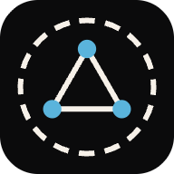
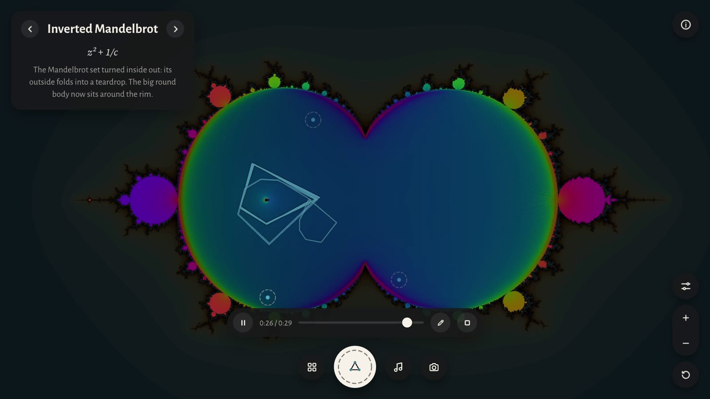

<p align="center"></p>

<h1 align="center">Mundana</h1>

<p align="center">Press any point of a fractal and hear its orbit.<br>
<a href="https://mundana.anxchywl.dev"><b>Open Mundana</b></a></p>



A fractal is drawn by applying one formula to every point, over and over. Each point traces a path called its orbit.
Mundana plays that path as sound: sideways motion goes to the left speaker, up and down motion to the right.

- A point whose orbit settles into a loop plays a **steady note**. Each bulb of the Mandelbrot set is a different note.
- A point whose orbit never repeats plays **noise**.
- A point whose orbit flies away plays **a click**, and its path turns red.

The name comes from *musica mundana*, the old idea that the planets make music as they move along their orbits.

## Features

- 24 fractals in four families: the Mandelbrot set and its relatives, the Burning ship family, chaotic maps and strange
  attractors
- Smooth morphs between fractals, where every frame in between is a real fractal
- Julia sets, three colour styles, slow motion and a pitch control
- Save a sound as WAV, save a picture, or copy a link to the exact view and point
- Play a song from a MIDI file or a recording: melody, chords, bass and drums on up to six voices, with a camera that
  follows the music
- Fix a song's notes in a piano roll while it plays
- Record the show as a video, or share the song as a link
- Works on phones and runs entirely in the browser, with nothing to install

## Usage

Press and hold anywhere on the picture, and drag to glide between sounds. Zoom in near the edges, where the most
interesting sounds are. Headphones help.

| Key | Action |
|---|---|
| `G` | Gallery of fractals |
| `[` `]` | Previous and next fractal |
| `X` | Random fractal and point |
| `J` | Julia set: hold and move to choose, release to keep |
| `C` | Colour style |
| `A` | Slow motion |
| `D` | Notes fade out |
| `W` `S` `L` | Save the sound, save the picture, copy a link |
| `R` | Reset the view |
| `Space` | Hold and drag to move the view |
| `H` | About |

### Songs

Press the music button and choose a MIDI file or a recording (MP3, WAV, M4A, OGG or FLAC). Every note becomes a point
whose orbit loops at that pitch. Drums are a click for the kick and noise for the snare and hats.

The song panel sets the part each track plays, how many notes sound at once, and which fractal each part uses. A song
can stay on one fractal, change fractal at each section Mundana finds, or change every few bars.

Notes from a recording are approximate. They work well for a solo instrument or a clear voice, and roughly for a dense
band mix. Fix them in the piano roll, or turn on the original recording underneath.

Limits: MIDI files up to 4 MB, recordings up to 50 MB, and songs up to 10 minutes and 20,000 notes.

## Run locally

There is nothing to build and there are no dependencies. Serve the folder over HTTP, since browsers only allow the
audio engine on a served page:

```bash
git clone https://github.com/anxchywl/Mundana.git
cd Mundana
python3 -m http.server 5178
```

Then open http://localhost:5178. It needs a browser with WebGL2 and AudioWorklet support.

Run the tests with Node 22 or newer:

```bash
node --test tests/*.test.mjs
```

Add `#debug=1` to the address to see frame times and how closely the picture follows the sound.

## How it works

Plain JavaScript with no libraries. The picture is drawn with WebGL2, and the sound is made sample by sample on the
browser's audio thread.

| File | Role |
|---|---|
| `src/fractals.js` | Every fractal's formula, once for the sound and once for the picture |
| `src/renderer.js` | Draws the picture with WebGL2 |
| `src/voice.js` | The instrument: steps an orbit 4,400 times a second and smooths it into sound |
| `src/synth-worklet.js` | Runs up to six voices on the audio thread, each note on its exact sample |
| `src/main.js` | The page: pressing, zooming, the gallery, saving and links |
| `src/cantus/` | Song mode: reading MIDI files, hearing recordings, planning the show, the piano roll, video and song links |
| `tools/` | Scripts that build the point library and the test files |

### Adding a fractal

1. Add it to `src/fractals.js` with both formulas.
2. Run `node tools/find-spots.mjs` and copy its spots into `src/spots.js`.
3. Run `node tools/build-points.mjs` to rebuild the point library. The tests report when it is out of date.

## Privacy

Files and recordings are read in the browser and never uploaded. Song links contain notes and settings, never audio.
Visits and three actions (a first press, playing a song, recording a video) are counted anonymously with
[GoatCounter](https://www.goatcounter.com), without cookies.

## Known limits

- Zoom stops at about 1/50,000 of the starting view, because browsers draw in single precision.
- Heavier fractals can be slow on older devices.
- Phones in silent mode may mute the sound.

## Contributing

Issues and pull requests are welcome. Please run the tests before opening a pull request. To report a security
problem, [open an issue](https://github.com/anxchywl/Mundana/issues).

## License

[MIT](LICENSE)
